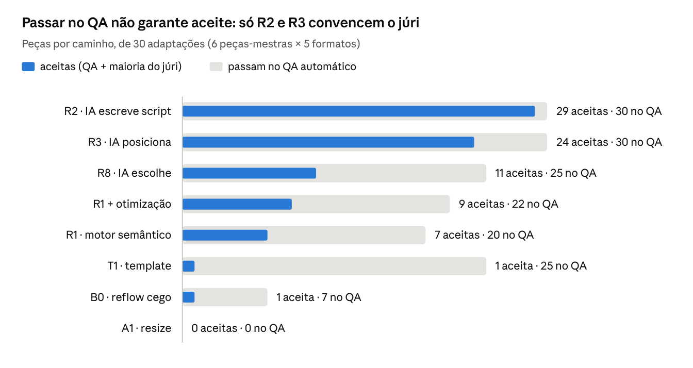
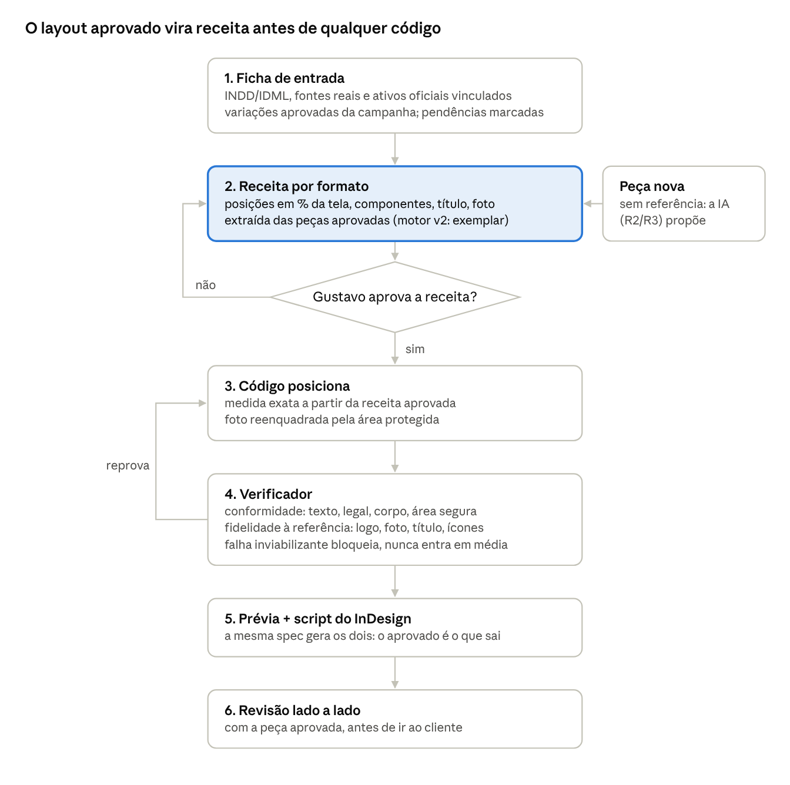

# DESDOBRA — Aprendizados até 06/11/2026

06/11/2026 · @Gustavo

## Resumo

No desdobramento, **o layout já aprovado da campanha é contrato, não sugestão**. A IA deve ler e seguir esse sistema; o código posiciona com medida exata; uma pessoa aprova a receita antes e a peça depois.

- **Bancada sintética (300 peças, 720 julgamentos):** venceu "a IA monta o layout de cada job" (R2: 29/30 aceitas). O motor genérico (R1) e o "IA escolhe, motor posiciona" (R8) ficaram presos à qualidade do motor.
- **Caso real (Praça CCN Comercial, 17 peças):** o mesmo R2 foi **todo reprovado**. A IA inventou uma composição nova em vez de seguir as variações aprovadas, e o verificador aprovou 17/17 porque mede conformidade, não fidelidade.
- **Caso que deu certo (Open Life):** spec em mm única para prévia e InDesign, receita por página decidida antes do código, travas contra texto inventado, 6 rodadas de revisão humana.
- **Motor v2 (banco de 75 peças medidas):** copia a estrutura de peças aprovadas (exemplar/analogia). Sobreposição com a arte real 0,45 contra 0,09 de esticar. É o caminho mais promissor; falta foto, travas e InDesign.

## De onde partimos

Até a bancada, nenhum caminho de desdobramento tinha produzido peças medidas: havia pesquisa, arquitetura e uma recomendação provisória nunca testada.

| Frente | Data | O que deixou |
| --- | --- | --- |
| Template de fluxo (Nano Banana) | 02/set | Fluxo generativo "em leque" para 16 formatos; só o schema foi validado |
| Semantic Layout Harness | 09/set | Contratos Layout IR, Adaptation Contract e Run Record; auditoria pediu um braço "cego à semântica" e uma regra de parada |
| Motor InDesign | 25/set | .jsx que copia objetos rotulados do IDML; teste no InDesign 21.5.1 passou em 3 de 4 itens |
| PROMPT_MESTRE (F0–F7) | 10/out | Rotas R1–R8; recomendação provisória "R8 com R1 no centro"; meta: −30% de minutos humanos por peça aceita |
| Pesquisas no Drive (pasta DESDOBRA) | 10/out | 5 rupturas: IA nunca emite geometria, legal bloqueante, PSD não se regrava sem Adobe, template tax |
| P31–P33 | 14–15/out | Medidas não se aprendem de peças antigas (0/6), mas com 9 medidas declaradas o layout fechou 14/14; peça-mãe = sistema de marca |
| Open Life | 20–21/out | Book A3 de 50 páginas + reprint a partir de uma spec em mm, 6 versões aprovadas |
| Revisão de artigos | 02/nov | Regras de QA: quase-alinhado (6,5%), corpo mínimo, ≤ 3 níveis de importância, fidelidade = tamanhos relativos + ranking |

No GitHub só o APP_SETOR toca o tema, como meta de negócio: "IA de KV em produção" e "redução de 30% no desdobramento" até dez/2026.

## Os caminhos comparados

Nove caminhos, do mais burro ao mais livre; a diferença entre eles é quem decide a composição.

| Sigla | Caminho | Quem decide a composição | Usa IA |
| --- | --- | --- | --- |
| A0 | Letterbox (encolhe e centraliza) | ninguém | não |
| A1 | Resize proporcional (tipo Magic Resize) | regra geométrica | não |
| B0 | Reflow cego | motor, sem saber papéis | não |
| T1 | Template por formato | uma matriz por formato, para qualquer KV | não |
| R1 | Motor semântico | motor com papéis, prioridades e grupos (3 estratégias) | não |
| R1opt | R1 + otimização | busca local sobre as notas automáticas | não |
| R8 | IA escolhe, código posiciona | IA escolhe estratégia e 6 parâmetros de um vocabulário fechado | sim |
| R3 | IA posiciona direto | IA escreve o JSON da peça | sim |
| R2 | IA escreve o script do job | IA escreve um programa de layout por job | sim |

O motor v2 (seção própria) é um décimo caminho, posterior à bancada: o motor copia a estrutura de peças **aprovadas** em vez de regras genéricas.

## A bancada de teste

Uma bancada sintética de 6 peças-mestras × 5 formatos × 11 braços gerou 300 peças em ~1 hora, com o mesmo verificador e o mesmo júri para todos.

- **Peças-mestras:** 6 KVs 1920×1080 no formato do caso real: 3 Bioma (produto, sustentabilidade com 3 ícones e o legal real do briefing, piscina com texto sobre foto) e 3 OTIUM (segunda marca, sem legal; living com foto de baixa resolução). Fotos e logos sintéticos.
- **Formatos do enxoval Bioma:** e-mail 600×1200, post 1080×1350, card 1080×1080, stories 1080×1920 (área segura), banner 970×250.
- **Render e medição:** Chromium real; o texto é medido pela tinta dos glifos, a mesma régua para motor e verificador.
- **Verificador (regras duras):** texto e ativos idênticos, nada inventado, corpo mínimo por papel, sem estouro, área segura, logo inteiro e ≥ mínimo, sem distorção, sem colisão, faixa sob texto sobre foto, prédio visível, contraste WCAG medido no pixel.
- **Braços com IA:** 24 agentes, no máximo 3 verificações por formato; réplicas de R8 e R3 em 3 peças.
- **Júri cego:** 18 agentes (diretor de arte, revisor de marca/jurídico, cliente) × 6 peças, ranking de 8 versões + "mandaria ao cliente sem retoque estrutural?" = 720 julgamentos. Concordância entre jurados τ = 0,75–0,78.
- **Aceita** = passa no QA **e** pelo menos 2 dos 3 jurados mandariam.

## Resultados da bancada

Na bancada sintética, só os caminhos em que a IA monta o layout passaram pelo júri: R2 com 29 de 30 aceitas e R3 com 24. Os motores ficaram em 11 ou menos. No caso real, o mesmo R2 foi todo reprovado (seção seguinte): este resultado vale para peça sem sistema de campanha a seguir.

*bancada R01 · 300 peças, 720 julgamentos cegos · runs/R01/analysis.json*

A distância entre a barra cinza e a azul é o que o QA automático não enxerga: o template passa em 25 e só 1 é aceita.

| Caminho | Tokens por job (5 formatos) | Tempo por job | Variação entre réplicas |
| --- | --- | --- | --- |
| R2 | ~138 mil | ~5,7 min | não medida |
| R3 | ~119 mil | ~5,5 min | mesma aprovação no QA em 15/15 |
| R8 | ~103 mil | ~2,4 min | mesma aprovação 15/15, mesma estratégia 12/15 |
| Motores sem IA | 0 | < 1 s | determinísticos |

- **Confrontos pareados (mesma adaptação):** R2 × R8 29–1; R3 × R8 27–3; R8 × R1 16–11; R1 × B0 19–9; R1opt × R1 15–14.
- **Reaproveitamento do R2:** de 30 cruzamentos script → outra peça, 2 rodaram e 0 de 10 peças passou no QA.
- **Onde o R8 travou:** título colado no topo (acentos 1–2 px fora da área segura) e faixa da estratégia S2 cobrindo o prédio; o vocabulário fechado não tinha como corrigir.

## O caso real que falhou: Praça CCN Comercial

O R2 aplicado a um job real gerou 17 peças, o verificador aprovou 17/17 e a agência reprovou todas: "as peças realmente ficaram muito ruins, horríveis, todas reprovadas".

**Job:** performance de lançamento comercial (salas 22–41 m², lajes 740–1.160 m²), feed 1:1, stories, reels 9:16 e 1:1 e carrossel 4:5.

| O que a agência aprovou | O que a IA fez |
| --- | --- |
| Foto sangrada (100% no 1:1) | Foto em banda no topo (34–50% da peça) |
| Degradê duotone sobre a foto | Bloco verde chapado embaixo |
| Produto no topo à direita, pareado com o logo | Produto no rodapé |
| Título em caixa alta centralizado | Caixa de sentença, alinhado à esquerda |
| 4 ícones sobre a foto, tarja branca no rodapé, crédito da perspectiva | 3 ícones no bloco, sem tarja, sem crédito |
| m² | m2 |

**Causas:**

1. **Sem referência de layout aprovado.** A página 28 do KV ("Variações do layout") já trazia o desdobramento comercial diagramado; a IA viu a miniatura e não abriu.
2. **Briefing mal lido.** "Não parecer o mesmo anúncio" virou licença para trocar o sistema.
3. **A mãe era documentação, não contrato.** Nada obrigava o script a respeitá-la.
4. **Verificador cego à fidelidade.** Mede margem, corpo, contraste e texto literal; aprovou peças fora do sistema.
5. **Entrada pobre.** Só JPG; os INDD/IDML das peças não foram abertos; fonte substituta (a Atyp estava no pacote do Reprint).
6. **Pendências chutadas em silêncio** ("Comando (briefing)", "[novo]") em vez de marcadas.

## O caso que deu certo: Open Life

O Open Life (book A3 de 50 páginas + reprint A5) chegou à v6 aprovada porque a composição foi decidida e aprovada **antes** do código, e o código só executou com medida exata.

| O que fez | Por que importa |
| --- | --- |
| Sistema de marca lido inteiro (guia página a página, paleta em RGB e CMYK, fonte real procurada) | a peça-mãe é o sistema, não uma peça |
| Material oficial sempre vinculado; ajuste só em cópia derivada | nada redesenhado, nada inventado |
| Uma spec em mm (`pecas.py`) gera a prévia e o script do InDesign | o que se aprova é o que sai |
| Travas no modelo: `literal()` só aceita texto dos docx; `marcacao()` marca o que falta; `dupla()` recusa texto na dobra; legal ≥ 6 pt | erro vira parada, não peça errada |
| Componentes por tipo de página (perspectiva em dupla, planta, realizadores, legenda com cor pela luminância) | repetição consistente |
| Receita escrita por dupla e por face do reprint | a direção de arte fica explícita e revisável |
| Regras de DA do Gustavo (ritmo, fachada inteira, sem caixinhas, duplas sem misturar assuntos) | critério humano como dado |
| 6 rodadas com revisão visual de todas as pranchas | "pegou o que nenhum teste pega" |

Limites que também valem: o script nunca rodou no InDesign real (só num simulado) e a economia de tempo não foi medida.

## Motor v2: banco de 75 peças medidas

O motor v2 corrige o erro do caso real: em vez de inventar, copia a estrutura de peças que a agência já aprovou, e mede isso honestamente contra 54 artes reais.

**Como decide:** para o formato pedido, usa a peça medida mais parecida ("exemplar") ou repete a mudança que a agência fez num par parecido ("analogia"); a escolha é aprendida por molde (KV e COMANDOS → exemplar; performance → analogia). Conteúdo, cores e quebras de linha vêm da mãe; larguras medidas com as fontes reais.

| Método | Sobreposição com a arte real (IoU) | Erro de posição (mediana) |
| --- | --- | --- |
| Esticar proporcionalmente | 0,09 | 14,1% |
| Só âncoras da mãe | 0,17 | 9,2% |
| **Motor v2** | **0,45** | **2,6%** |

Validação sem "cola": peças do mesmo grupo ficaram fora das escolhas, inclusive da tabela de modos.

**Lacunas encontradas no código e nas amostras:**

- A foto não é reenquadrada; a prévia usa a foto da mãe desfocada.
- Horizontais (1200×628, 1280×720, 1920×1080) e banners saem vazios, com elementos pequenos e soltos.
- O ajuste reduz o texto até −24% sem corpo mínimo.
- O legal pode sair quando o exemplar não tinha; no Bioma ele é bloqueante.
- Sem checagem de contraste nem de área protegida da foto.
- 0,45 é rascunho: 5 de 54 pares abaixo de 0,2, só 9 acima de 0,6.
- Para rodar precisa do `banco.json` e da pasta `pecas/` (arte de cada mãe), que ainda não vieram para esta sessão.

## Princípios aprendidos

Doze regras para o próximo job, cada uma tirada de um resultado medido ou de um erro visto.

1. **Layout aprovado é contrato.** Se a campanha já tem peças ou variações aprovadas, o desdobramento segue a estrutura delas; liberdade de composição só em peça nova sem referência (caso Praça).
2. **Receita antes do código.** Posições em % da tela, componentes, caixa e alinhamento do título, cobertura da foto — aprovadas por uma pessoa antes de gerar (Open Life).
3. **A IA escolhe, o código posiciona, a pessoa aprova.** Quem posiciona é o código com medida exata; a IA decide dentro do que foi aprovado.
4. **Peça-mãe = sistema de marca + variações aprovadas**, não uma imagem solta (P33, Open Life).
5. **Entrada real ou nada:** INDD/IDML, fontes reais, ativos oficiais vinculados. Só JPG = rascunho.
6. **O que falta vira marcação visível**, nunca chute silencioso.
7. **QA é portão, não juiz.** O template passou no QA em 25 de 30 peças e só 1 foi aceita; o verificador aprovou 17/17 peças reprovadas no caso real.
8. **Fidelidade tem que ser medida.** Além de margem, corpo e contraste: sobreposição com a peça de referência, posição do logo, cobertura da foto, contagem de ícones, tarja, crédito.
9. **Semântica se paga.** Com papéis e grupos, o motor venceu o mesmo motor sem papéis por 19 a 9.
10. **Métricas automáticas são burláveis.** Otimizar a nota suave não melhorou nada (15–14); um agente inflou "preenchimento" com faixas da cor de fundo.
11. **Código de IA por job é descartável.** 0 de 10 peças passou quando o script de uma peça rodou em outra. O que se reaproveita é o verificador, a tabela de formatos e o formato da IR.
12. **Legal é bloqueante.** Falta de legal, logo cortado, texto errado ou prédio mutilado reprovam sempre, nunca entram em média.

## Arquitetura recomendada agora

Junta o que deu certo no Open Life com o motor v2: a receita de cada formato sai das peças aprovadas, é aprovada por uma pessoa e só então o código posiciona.

*arquitetura recomendada · 6 etapas, 1 aprovação, 2 voltas*

A IA trabalha nas etapas 1 e 2 (ler o sistema, extrair a receita, propor peça nova); o código nas etapas 3 a 5; a pessoa na aprovação e na etapa 6.

## Erros de método e cuidados com testes

A bancada apontou o R2 como vencedor e o caso real o reprovou: o teste mediu a pergunta errada.

| Erro da bancada | Efeito | Cuidado no próximo teste |
| --- | --- | --- |
| Peças-mãe sintéticas, sem sistema de campanha nem variações aprovadas | não havia "layout certo" para errar | testar com uma campanha real e suas peças aprovadas como gabarito |
| Júri de IA julgando "boa peça" | premiou o estilo da própria IA | júri humano e pergunta "é fiel à campanha?", com a peça aprovada ao lado |
| Verificador só de conformidade | aprova o que está fora do sistema | camada de fidelidade à referência |
| Motores determinísticos feitos em ~1 hora | R1/R8 subestimados | comparar com um motor maduro (ex.: motor v2) |
| Sem cronômetro humano | não mede a meta de −30% | medir manual × ajuste da peça gerada no mesmo job |

O que funcionou e vale repetir: mesma régua de medição para gerador e verificador, júri cego com chave guardada fora, braço "cego à semântica" como controle, réplicas para medir variação e validação sem "cola" (como a do motor v2).

## Pendências e próximos passos

O próximo passo é refazer as 17 peças da Praça pelo caminho novo e medir o tempo de ajuste contra o manual.

- [ ] Escrever a receita por formato da Praça a partir das peças aprovadas (a sessão "OPA" já está medindo) e aprovar antes de gerar
- [ ] Rodar o motor v2 com `banco.json` + `pecas/` e as melhorias: reenquadrar a foto pela área protegida, corpo mínimo, legal obrigatório, contraste
- [ ] Acrescentar ao verificador a camada de fidelidade (IoU com o exemplar, logo, foto, título, ícones, tarja, crédito)
- [ ] Medir peças nos formatos que faltam no banco (horizontais; quadrado de KV e COMANDOS)
- [ ] Escrever o `.jsx` que lê o JSON de layout e monta no InDesign, e rodar no InDesign real com as fontes ativas
- [ ] Julgamento cego com 3 designers da agência (manual × motor) e cronômetro de ajuste: fecha a meta de −30%
- [ ] Medir o custo de preparar cada KV (pendência P041: em jobs de ~5 peças a preparação pode comer a economia)
- [ ] Pendências antigas do Bioma: legal de aquecimento solar, água de chuva e coleta (P040); regras do guia nas peças digitais (P042)

## Onde estão os arquivos

Tudo da bancada está no repositório [gustavoquinteros/teste_](https://github.com/gustavoquinteros/teste_/tree/claude/agent-parallel-testing-4rg2b1/bancada), branch `claude/agent-parallel-testing-4rg2b1`, pasta `bancada/`.

| Arquivo | Conteúdo |
| --- | --- |
| `RELATORIO.md` | Relatório geral da bancada + atualização após o caso real |
| `RELATORIO_R8.md` | Relatório técnico do R8 (produção) |
| `RELATORIO_R2.md` | Relatório técnico do R2 (produção + júri) |
| `APRENDIZADOS/` | Este documento, com o gráfico e o diagrama |
| `engine/` | Motores, verificador, júri cego e análise |
| `runs/R01/` | 300 peças (JSON e PNG), QA de cada uma, 720 julgamentos, custos |
| `runs/T01/` | Teste de reaproveitamento dos scripts do R2 |

Fora do repositório: relatório do Open Life (PDF), motor v2 e ferramentas (zips enviados nesta conversa), e a sessão "OPA" com o caso da Praça, no computador do Gustavo.
