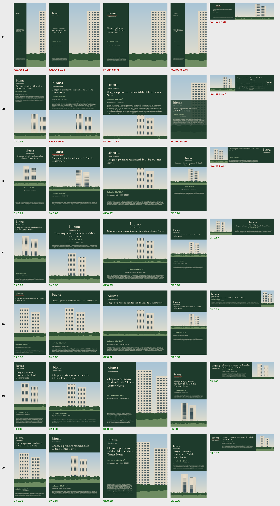

# Bancada de desdobramento — rodada R01 (06/11/2026)

**Pergunta:** qual caminho automatiza melhor o desdobramento de KV (peça-mestra 16:9 → enxoval de formatos)?
**Resposta curta:** nesta bancada venceu **"a IA monta o layout de cada job, o código verifica"** (R2 e R3).
A recomendação provisória anterior (R8 com R1 no centro: "a IA só escolhe, o código posiciona") ficou em 3º,
porque fica presa à qualidade do motor genérico. Templates fixos por formato passam no QA e perdem no júri.

## O que foi testado

- **6 peças-mestras** sintéticas 1920×1080 no formato do caso real: 3 Bioma (produto, sustentabilidade com 3 ícones
  e o texto legal real do briefing, piscina com texto sobre foto) e 3 OTIUM (segunda marca, sem legal; living com foto
  de baixa resolução). Mesmo esquema do Kernel V0 do Semantic Layout Harness (papéis, prioridade, relações, área protegida).
- **5 formatos do enxoval Bioma:** e-mail 600×1200, post 1080×1350, card 1080×1080, stories 1080×1920 (área segura), banner 970×250.
- **11 braços × 30 adaptações = 300 peças**, renderizadas no Chromium com medição real de texto.
- **QA automático (mesma régua para todos):** conteúdo e texto idênticos, nada inventado, corpo mínimo por papel e formato,
  texto sem estouro, área segura, logo inteiro e ≥ mínimo, sem distorção, sem colisão, texto sobre foto só com faixa,
  contraste WCAG medido no pixel, prédio/piscina visível. Mais notas suaves (alinhamento 6,5%, Size Rel, ordem de leitura, hierarquia).
- **Júri cego:** 18 agentes (diretor de arte, revisor de marca/jurídico, cliente incorporadora) × 6 peças, ranking de 8 versões
  por formato + "mandaria ao cliente sem retoque estrutural?" → **720 julgamentos**. Concordância entre jurados: τ = 0,75–0,78.
- **Réplicas** (outro agente, mesma peça) para R8 e R3; **teste de reaproveitamento** dos scripts do R2 em outras peças.

| Braço | O que é |
|---|---|
| A0 | letterbox (piso do harness) |
| A1 | resize proporcional (reposiciona + recorta a foto) — o "Magic Resize/Liquid Layout" |
| B0 | reflow cego: mesmas 3 estratégias do R1, sem papéis/prioridade/relações (braço da auditoria C-01) |
| T1 | template por formato: regiões declaradas uma vez por formato (padrão de medidas P31/P33) |
| R1 | motor semântico genérico: 3 estratégias (bandas, âncora, preservar estrutura), melhor de 3 pelo QA |
| R1opt | R1 + busca local estilo O'Donovan (45 iterações) |
| R8 | IA escolhe estratégia/parâmetros de um vocabulário fechado; o motor posiciona (≤3 verificações/formato) |
| R3 | IA escreve o JSON do layout direto, usa o verificador (≤3/formato) |
| R2 | IA escreve um script de layout próprio para o job, usa o verificador (≤3/formato) |

## Resultado

| Braço | Passa no QA | Júri: nota | Júri: enviaria | **Aceitável¹** | Tokens/peça | s/peça |
|---|---|---|---|---|---|---|
| A1 resize | 0/30 | 0,10 | 0% | 0/30 | 0 | 0,01 |
| B0 cego | 7/30 | 0,34 | 12% | 1/30 | 0 | 0,2 |
| T1 template | 25/30 | 0,28 | 7% | 1/30 | 0 | 0,01 |
| R1 semântico | 20/30 | 0,46 | 21% | 7/30 | 0 | 0,2 |
| R1opt | 22/30 | 0,46 | 24% | 9/30 | 0 | 0,9 |
| R8 IA escolhe | 25/30 | 0,58 | 43% | 11/30 | ~20,5 mil | 29 |
| **R3 IA posiciona** | **30/30** | 0,87 | 79% | **24/30** | ~23,8 mil | 66 |
| **R2 IA script/job** | **30/30** | **0,91** | **96%** | **29/30** | ~27,7 mil | 70 |

¹ passa em todas as verificações duras **e** a maioria dos 3 jurados mandaria ao cliente sem retoque estrutural.
Diretor de arte (o mais exigente) mandaria: R2 93%, R3 63%, R8 23%, R1 7%, T1 3%.

Confrontos pareados (mesma adaptação): R2 × R8 **29–1**; R3 × R8 27–3; R8 × R1 16–11; R1 × B0 19–9; R1opt × R1 15–14; R2 × R3 17–13.



## O que isso confirma ou derruba do que vínhamos construindo

1. **"Nenhum score compensa violação" e "QA em código" — confirmado, mas o QA não basta.** T1 passa em 25/30 e só 1 é aceitável;
   R1 passa em 20 e 7 são aceitáveis. O QA automático é um **portão** (barra o inviabilizante), não um **juiz** de qualidade.
   As notas suaves não capturam o que o júri premia: R1opt (otimizar a nota suave) não melhorou nada (15–14), e um agente
   R3 inflou "preenchimento" com faixas da cor de fundo — a métrica é gameável.
2. **Semântica é load-bearing — confirmado** (regra de parada da auditoria): o semântico vence o cego 19–9; o cego empata/vence
   em 11/30, abaixo do limiar de parada. Papéis, prioridades, grupos e área protegida pagam o custo de anotar.
3. **"A IA escolhe, o código posiciona" (R8) — limitado pelo motor.** O R8 ganha do R1 (16–11) e é reprodutível
   (réplica: mesma elegibilidade 15/15, mesma estratégia 12/15), mas os 6 agentes bateram no mesmo teto: o vocabulário fechado não
   corrige o que o motor faz mal (título colado no topo, acento da Cormorant 2 px fora da área segura; faixa cobrindo o prédio).
   R8 é tão bom quanto o motor que está embaixo.
4. **O que separou as melhores (todos os jurados disseram o mesmo):** preservar a **gramática do KV** — painel ao lado da foto, bloco
   logo→título→info alinhado à esquerda, quebra do título, fachada/piscina inteiras — em vez de uma regra genérica de reflow.
   R2/R3 leem isso da peça-mestra a cada job; os motores genéricos centralizam e empilham sempre igual.
5. **Templates por formato (T1) não substituem leitura do KV:** "uma matriz por formato, para qualquer KV" passa no QA e é rejeitada
   (vazios, foto pequena, hierarquia plana). Coerente com a P31/P33: medidas-padrão funcionam **dentro de uma família de peças**,
   não entre KVs diferentes.
6. **I6 (segunda marca sem código novo):** deterministas e R8/R3 rodam OTIUM sem tocar em código. **R2 não**: o script é do job —
   de 30 cruzamentos script→outra peça, 2 rodaram e 0 de 10 peças passou no QA. O código que a IA escreve é descartável.
   Isso não derruba o R2: o produto dele é a **IR (JSON)**, e a IR alimenta o mesmo verificador e o mesmo exportador; o que não se
   reaproveita é o script, que custa ~28 mil tokens por peça e ~70 s.
7. **Resize/letterbox:** 0/30 em qualquer critério — confirma o veto a resize nas recomposições.

## Caminho recomendado (a ser validado no piloto real)

> **A IA lê o KV e monta a IR de cada formato (estilo R3/R2) → o verificador em código é portão obrigatório (o mesmo desta bancada)
> → a IR aprovada vira arquivo editável pelo Motor InDesign (.jsx que copia objetos rotulados) → a pessoa fecha.**

- Mantém as invariantes: IA não inventa conteúdo (verificado: texto, ativos e fontes idênticos), nenhum score compensa violação,
  saída editável (I5) e dados de marca/formato como tabela (I6 vale para o verificador e o exportador, não para o layout).
- O R1/R8 fica como **plano B barato e determinístico** (custo zero, ~0,2 s) e como "primeiro rascunho" que a IA pode corrigir.
- Começar por R3 (IA posiciona direto, sem escrever código): 24/30 aceitáveis, mais barato que R2 e sem script descartável;
  usar R2 nos casos difíceis (banner, legal longo) onde ele foi melhor.

## Limites desta rodada (o que NÃO está provado)

- **Peças sintéticas**, não os IDML reais (Bioma v12 / OTIUM). Fotos são ilustrações simples; nada de PSD/InDesign real.
- **Júri de IA**, não designers da agência. Cego e com boa concordância, mas é do mesmo tipo de modelo que gerou R2/R3
  (possível preferência pelo próprio estilo). O piloto precisa dos 3 designers humanos.
- **Motores deterministas feitos em ~1 h** e ajustados só numa peça (bioma_produto); um R1 maduro pode ir muito mais longe.
  Mas o R1 já é o "R1 genérico" que a F4 previa; o teto que ele mostrou é real.
- **Tempo humano não medido** (H1 do piloto: −30% minutos/peça aceita). Aqui só há tempo de máquina.
- R2 não teve réplica; R3 teve (estável). Orçamento igual: ≤3 verificações por formato para todos os braços com IA.

## Próximo passo sugerido

1. Rodar R3 + verificador sobre **1 KV real** (IDML da pasta `kv/` do caso Bioma convertido para IR pelo leitor `tree.py` já escrito),
   nos 5 formatos, e exportar via Motor InDesign.
2. Julgamento cego com **3 designers** (M manual × R3 × R1), cronometrando ajuste — fecha H1, H2 e H4 do piloto.
3. Endurecer o verificador com o que o júri apontou e o QA não pegou: vazio morto, centralizar o que o KV alinha à esquerda,
   foto pequena, legal maior que o CTA.

## Como reproduzir

```
cd bancada
python3 engine/make_assets.py && python3 engine/make_fixtures.py
node engine/bench.mjs engine R01 all all all     # bracos deterministicos
node engine/bench.mjs eval R01                   # render + QA de todos os candidatos
python3 engine/make_blind.py R01 <chave.json>    # pranchas cegas
python3 engine/analyze.py R01 <chave.json>       # tabelas (runs/R01/analysis.md)
```
Ferramenta dos agentes: `node engine/bench.mjs check <candidato.json>`; plano R8: `node engine/bench.mjs plan <peça> <formato> '<json>' <saída>`.
Instruções: `AGENT_BRIEF.md` (geradores) e `JUDGE_BRIEF.md` (júri). Resultados brutos em `runs/R01/` (candidatos, checks,
julgamentos, `usage.json` com tokens e tempo por agente) e o teste de reaproveitamento em `runs/T01/`.
